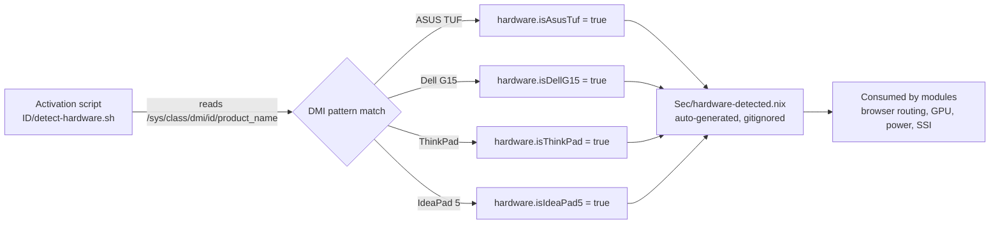
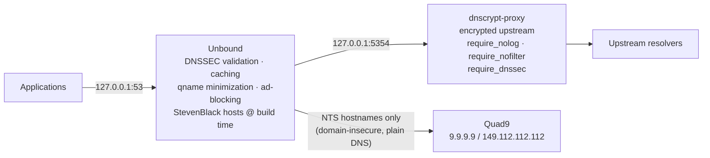

# Velonia

      

A personal NixOS configuration for daily-driver laptops, built over time with an emphasis on:

- security
- network privacy
- development tooling
- penetration testing
- AI/ML workflows (exists but often proven unrealistic sorry if you had rainbow dreams because of what the hardware companies gives as a sorry excuse of a vram *coughs~ Nvidia* while spitting on us for most consumer hardware at best, that's your sign that you know a human was behind this code)

The configuration is declarative throughout, everything is expressed in Nix, with secrets kept in an excluded `Sec/` directory.

> **Started**: 10/11/2023 (DD/MM/YYYY)  
> **Last reviewed:** 1/11/2026 (D/MM/YYYY)

---

## Table of Contents

1. [Repository Layout](#repository-layout)
2. [Hardware Detection](#hardware-detection)
3. [Boot and Kernel](#boot-and-kernel)
4. [Graphics](#graphics)
5. [Desktop & Browsers](#desktop--browsers)
6. [Networking & Security](#networking--security)
7. [Development Environment](#development-environment)
8. [Python/ML Package Overlays](#pythonml-package-overlays)
9. [Services & Daemons](#services--daemons)
10. [Terminal Environment](#terminal-environment)
11. [Custom Packages & Scripts](#custom-packages--scripts)
12. [Nix Configuration](#nix-configuration)
13. [Secrets Management](#secrets-management)
14. [Design Decisions](#design-decisions)
15. [Getting Started](#getting-started)

---

## Repository Layout

The repository lives at `/etc/nixos/` and is structured so that each concern owns its own directory. The root `configuration.nix` is the single entry point that imports everything else.

```
/etc/nixos/
├── configuration.nix        # Single entry point, imports everything below
├── control-hardware.nix     # Overrides hardware-configuration.nix boilerplate
├── desktop.nix              # KDE Plasma 6 / Wayland / SDDM
├── graphics.nix             # NVIDIA driver, CUDA, per-machine GPU config
├── nix-system.nix           # Nix daemon settings, channels, build limits
├── security.nix             # Boot/kernel hardening parameters
├── systemd.nix              # systemd-level tweaks
├── ID/                      # Hardware detection (DMI → Sec/hardware-detected.nix)
├── Networking/              # DNS stack, firewall, hardening, time sync, Warp
├── Dev/                     # Languages, LSPs, IDEs, overlays (see Dev/README.md)
├── Services/                # Ollama, SearXNG, Syncthing, OBS, gaming, pentest...
├── Terminal/                # Bash, Starship, tmux
├── Programs/                # Custom packages & Python scripts
├── Nix-Shells/              # Ad-hoc dev shells
├── VMISO/                   # VM & ISO build configurations
└── Sec/                     # .gitignore'd secrets (see Secrets Management)
```

The `ztop.nix` convention is used throughout: every directory that groups multiple files provides a `ztop.nix` that imports all siblings, so the parent only needs to import that single file.

> **Note**: The file `control-hardware.nix` is for overriding logic in `hardware-configuration.nix` without modifying auto-generated boilerplate directly, per the guidelines outlined in the [Getting Started](#getting-started) section.

---

## Hardware Detection

Because the same repository is shared across multiple machines:

| Machine | Role |
|---|---|
| **ASUS TUF Gaming A15** | (I burned that one haha sad) |
| **Dell G15** | Daily driver |
| **IdeaPad 5** | Daily driver |
| **ThinkPad T14 G1 AMD** | Currently developing this configuration on |

An activation-time shell script (`ID/detect-hardware.sh`) reads `/sys/class/dmi/id/product_name`, matches it against known DMI patterns, and writes a small Nix file to `Sec/hardware-detected.nix`. That generated file sets four boolean options (`hardware.isAsusTuf`, `hardware.isDellG15`, `hardware.isThinkPad`, `hardware.isIdeaPad5`) declared in `ID/ID.nix` and consumed wherever hardware-specific behavior is required.



---

## Boot and Kernel

The system uses **systemd-boot** with EFI. Several categories of kernel parameters are set explicitly.

Key configuration files:

- [security.nix](security.nix)
- [control-hardware.nix](control-hardware.nix)
- [Network_Kernel_Parameters.nix](Networking/hardening/Network_Kernel_Parameters.nix)

These parameters are tailored to specific system requirements and explicitly documented so system diagnostics remain straightforward.

---

## Graphics

NVIDIA GPUs are configured via [graphics.nix](graphics.nix):

- **ASUS TUF**: Single dedicated GPU (no integrated graphics).
- **Dell G15 & Lenovo IdeaPad 5**: Hybrid dedicated + integrated graphics.

`hardware.nvidia` is configured with the latest proprietary driver, modesetting enabled, `powerManagement.enable = true`, and `dynamicBoost.enable = true`. `forceFullCompositionPipeline` is left off deliberately; tear-free rendering is handled at the X server screen-section level.

`nixpkgs.config.cudaSupport = true` is set globally, enabling CUDA support across matching packages with binary cache substituters enabled.

---

## Desktop & Browsers

### Desktop Environment

KDE Plasma 6 runs on Wayland via SDDM with the KWin compositor. X.Org server is explicitly disabled (`services.xserver.enable = lib.mkForce false`). `programs.xwayland` remains enabled for legacy compatibility.

- **Portals**: Multiple XDG desktop portals (GTK, GNOME, KDE) are configured in parallel.
- **Environment Variables**: `NIXOS_OZONE_WL=1` (Chromium Ozone Wayland), `QT_QPA_PLATFORM="wayland;xcb"`, and `GSK_RENDERER=nvidia`.
- **Credentials**: KWallet PAM integration is disabled (`security.pam.services.sddm.kwallet.enable = false`) in favor of KeePassXC.

### Dual-Browser Routing (`Services/Browser.nix`)

- **ThinkPad**: Runs Zen Browser with pre-configured privacy extensions (uBlock Origin, ClearURLs, Consent-O-Matic, KeePassXC-browser, User-Agent Switcher, Port Authority).
- **Other Machines**: Runs Brave.

---

## Networking & Security

### DNS Architecture

Resolution flows through three isolated layers:



1. **Unbound** (`Networking/DNS/cache.nix` - `127.0.0.1:53`): DNSSEC validation, caching, query-name minimization, and ad-blocking (StevenBlack hosts fetched at build time).
2. **dnscrypt-proxy** (`Networking/DNS/resolver.nix` - `127.0.0.1:5354`): Encrypted DNS upstream (`require_nolog`, `require_nofilter`, `require_dnssec`).
3. **Upstream Resolvers**.

`systemd-resolved` and `resolvconf` are disabled. NetworkManager uses `dns = "default"`.

#### NTS bootstrap exception

The DNS/TLS stack and the clock depend on each other: chrony needs DNS and TLS to reach its NTS servers, but DNSSEC validation and TLS handshakes fail when the clock is wrong (e.g. dead CMOS battery, RTC reset). To break that deadlock, the four NTS server hostnames get a narrow exception in `cache.nix`:

- `domain-insecure` is set **only** for `time.cloudflare.com`, `ntppool1.time.nl`, `nts.netnod.se`, and `ptbtime1.ptb.de` — everything else keeps full DNSSEC validation (failing closed with a wrong clock is the point).
- Those names are forwarded over **plain DNS** to Quad9 (`9.9.9.9`, `149.112.112.112`) — no TLS handshake, so no certificate-date failure. The worst an attacker can do is make resolution fail: chrony still verifies the server's TLS identity and NTS authentication before trusting any time.

#### DHCP forward gating (per-connection)

The NetworkManager dispatcher script in `cache.nix` only forwards DHCP-provided search domains to the DHCP servers on **trusted connections**. An `internalDomains` allowlist maps NetworkManager connection IDs (`GU-Dorms`, `Gu_EMP`, `GU-Wifi`) to the internal domains they may resolve; unknown connections (e.g. `Library`) forward nothing, and each DHCP-provided zone is checked against that connection's allowlist before `unbound-control forward_add`.

#### Logging

Unbound runs with `verbosity = 0` and per-query/per-reply logging off; only `log-servfail` remains on so actual resolution failures still surface.

### Time Synchronization & Cloudflare Warp

- **Chrony & NTS Enforcement**: Replaces `systemd-timesyncd` with strict Network Time Security (NTS) enforcement (`iburst nts` configured in `Networking/TimeSync.nix`) via `time.cloudflare.com` and three other NTS servers to cryptographically secure system clock synchronization.
- **Boot-time clock recovery**: `makestep 1.0 3` lets chrony jump (not slew) the clock if it's off by more than 1 second during its first 3 updates, and `nocerttimecheck 1` skips only certificate *date* checks until the first clock update — chain and hostname verification stay active, so a fake server still can't hand the system a time. Note: `makestep` only applies to chronyd's first updates after start; if the clock drifts later, restart chronyd or run `sudo chronyc makestep`.
- **RTC in UTC**: `time.hardwareClockInLocalTime = false` — the hardware clock is treated as UTC. If dual-booting Windows, set its `RealTimeIsUniversal` registry value or the clock will drift by the local UTC offset.
- **`time-sync-recover` service** (`Networking/TimeSync.nix`): waits for chrony to synchronize (`chronyc waitsync`), then flushes Unbound's poisoned state (`flush_bogus` + `flush_infra all`, the latter clearing any "dnscrypt-proxy is unresponsive" backoff recorded during the clock failure) and restarts dnscrypt-proxy. Runs once per boot; if the clock goes wrong later (e.g. resume from suspend), run `sudo systemctl restart time-sync-recover`.
- **Cloudflare Warp** (`Networking/cloudflare-warp.nix`): Configured with WARN-level log filtering.

### Firewall

Handled by `nftables` with higher-level rules layered on top. `fail2ban` is enabled, and dropped/refused packets are logged.

<details>
<summary>Open ports (click to expand)</summary>

- TCP 53/5353/853 (DNS / DoT)
- TCP 443 (OpenVPN)
- TCP 8384, 22000 (Syncthing GUI & sync)
- TCP 8888, 18081 (Development - slated for removal)
- UDP 67/68 (DHCP hotspot mode)
- UDP 6881 (qBittorrent)
- UDP 21027 (Syncthing discovery)
- TCP/UDP 1714-1764 (KDE Connect)
- TCP/UDP 21114-21119 (RustDesk)

</details>

### Kernel Network Parameters

Managed in `Networking/hardening/Network_Kernel_Parameters.nix`:

<details>
<summary>Parameter details (click to expand)</summary>

- **Congestion Control**: BBR with `fq` qdisc.
- **Buffers**: Raised to 16 MB max.
- **IPv6**: Disabled system-wide.
- **RP Filter**: Loose mode (value 2).
- **SYN Cookies & Keepalives**: Enforced.

</details>

---

## Development Environment

### Languages (`Dev/Langs/`)

- **C++**: GCC 14 + LLVM/Clang 20, CMake, Ninja, GTest, GTK/Qt, Eigen, nlohmann_json.
- **Python**: Python 3.12 environment (PyQt, PySide, pandas, OpenCV, JAX, ONNX, SQLite, pymysql, Jupyter). Installed with `lib.lowPrio` to avoid virtualenv conflicts.
- **Rust / Go / Dart & Flutter / Java / Nix / SQL**: Full toolchain setups with LSPs (`nixd`, `gopls`, `rust-analyzer`, etc.) and formatters (`alejandra`).

### Domain-Specific Tools (`Dev/Specialized/`)

- **MySQL (MariaDB)**: Port 3306 (localhost only), InnoDB tuning, slow query logging, `utf8mb4`.
- **PostgreSQL**: Defined in modules (default `enable = false`).
- **UML & Diagrams**: Mermaid CLI, PlantUML, Graphviz.
- **Big Data & Docs**: Hadoop, Pig, Spark, Doxygen, Monolith.
- **Pandoc**: Markdown-to-PDF toolchain with XeLaTeX and PlantUML filter support.

### IDE: VSCodium

Configured via `Dev/IDEs/vscodium.nix` with modular extensions (`Dev/IDEs/VScode_Extensions/`) and declarative user settings (`Dev/IDEs/vscode_config.jsonc`).

---

## Python/ML Package Overlays

`Dev/overlays.nix` overrides Python packages to incorporate pre-built binary wheels (`torch-bin`, `torchaudio-bin`, `torchvision-bin`, `jaxlib-bin`) and custom derivations (`unsloth`, `flash-attn`, `vllm`, `xformers`, `smolagents`, `trl`, etc.).

<details>
<summary>Patch details (click to expand)</summary>

- **unsloth-zoo**: Patched for CRLF line endings (`dos2unix`), sudo removal, and PEP 621 license compliance.
- **xformers**: Parallel building disabled (`MAX_JOBS=2`) to prevent OOM errors.
- **vllm**: Patched for cmakeFlags, PYTHONPATH propagation, and sandboxed `lsmod` removal.

</details>

---

## Services & Daemons

### Status Overview

<details>
<summary>Service status list (click to expand)</summary>

- **Active / Core**: Ollama (AI stack on port 11434 with CUDA), SearXNG (metasearch on port 8880), PipeWire (audio with RTKit), Syncthing, QEMU/KVM Virtualization, Radicale (CalDAV/CardDAV on port 5232).
- **Hardware-Conditional**: Power Management (`asusd` disabled, `power-profiles-daemon` enabled per machine).
- **Disabled / Templated Stubs**: Nextcloud, Open-WebUI, Apache Tika, Podman, ArcadeDB, PostgreSQL.

</details>

### Additional Integrations

- **OBS Studio** (`Services/OBS.nix`): Configured with virtual camera support and plugins (`wlrobs`, `input-overlay`, `obs-pipewire-audio-capture`, `obs-gstreamer`, `obs-vkcapture`).
- **Secret Service Integration** (`Services/SSI.nix`): KeePassXC configured as the `org.freedesktop.secrets` D-Bus provider on ASUS TUF hardware.
- **Gaming & Penetration Testing**: Steam (Proton GE, Gamescope), Heroic, Bottles, and wireless auditing toolkits (`airgeddon`, `hostapd-wpe`).

---

## Terminal Environment

### Bash (`Terminal/bash.nix`)

- **Aliases**: `eza` integration (`ls`/`la`), `ripgrep` (`grep`), verbose `cp`/`mv`, `cpv` (rsync progress).
- **Custom Functions**: `switch`/`update`/`garbage` (nix-output-monitor wrappers), archive compression/extraction (`compress`/`extract`), media converters (`convert_to_mp4`, `pandocmarkdowntopdf`), yt-dlp wrappers, and utility helpers (`s` for sudo re-run, `sync_nixos_config`, `clean_stale_mount`).

### Starship Prompt

Two-line prompt showing directory, git remote icons & status, language indicators, and nix-shell status (`❄️ pure shell`, `❄️ impure shell`).

---

## Custom Packages & Scripts

- **Packages (`Programs/Packages/`)**: `airgeddon`, `evillimiter`, `hostapd-wpe`, Cisco Packet Tracer 8 (`requireFile` derivation), and pre-built binaries (whisper-cpp, LM Studio, Proton GE).
- **Python Scripts (`Programs/custom/Python/`)**: `ctj` (pyvips image conversion), `MD-PDF` (WeasyPrint Markdown-to-PDF), and `mac-formatter`.

---

## Nix Configuration

- **Experimental Features**: `nix-command`.
- **Build Limits**: Capped at 12 cores and 4 parallel jobs to prevent memory exhaustion.
- **Unfree**: `nixpkgs.config.allowUnfree = true` enabled globally.

### Nix Channels

The system is channel-based. Three channels are required:

```bash
$ sudo nix-channel --list
home-manager https://github.com/nix-community/home-manager/archive/release-26.05.tar.gz
nixos        https://nixos.org/channels/nixos-26.05
unstable     https://nixos.org/channels/nixpkgs-unstable
```

On a fresh machine, add them with:

```bash
sudo nix-channel --add https://nixos.org/channels/nixos-26.05 nixos
sudo nix-channel --add https://github.com/nix-community/home-manager/archive/release-26.05.tar.gz home-manager
sudo nix-channel --add https://nixos.org/channels/nixpkgs-unstable unstable
sudo nix-channel --update
```

The `home-manager` channel is what resolves the `<home-manager/nixos>` import in `configuration.nix`. Day-to-day, the `update` shell function wraps `nix-channel --update` + `nixos-rebuild switch --upgrade` (see [Getting Started](#getting-started)).

---

## Secrets Management

The `Sec/` directory is `.gitignore`d and contains:

- `secrets.nix`: Attribute set containing Wi-Fi passwords, MAC addresses, git email, and API keys. **Must** define `username` and `hostname`.
- `network-manager.env`: Environment file for NetworkManager PSK values.
- `hardware-detected.nix`: Auto-generated by activation script.

---

## Design Decisions

Choices that are deliberate rather than defaults — documented here so they don't get "fixed" by accident (or turn into issue threads).

### Channels, not flakes

This configuration is channel-based (`nixos`, `unstable`, `home-manager` — see [Nix Configuration](#nix-configuration)). Flakes are great, but channels keep the workflow simple on a multi-machine daily-driver setup: one `update` function, no lockfile churn, no flake registry drift to debug mid-rebuild. If that tradeoff stops making sense, this section is where the migration conversation starts.

### Wayland-first, X.Org forcibly off

`services.xserver.enable = lib.mkForce false` — not just unset, *forced* off, so a stray module can't silently re-enable it. Xwayland stays on for legacy apps. `forceFullCompositionPipeline` is deliberately left off; tear-free rendering is handled at the X server screen-section level instead.

### KeePassXC over KWallet

KWallet PAM integration is disabled in favor of KeePassXC as the `org.freedesktop.secrets` D-Bus provider (on supported hardware). One secret store, one database file, one thing to back up.

### Python at `lib.lowPrio`

The system Python environment is installed with `lib.lowPrio` so it never shadows project virtualenvs — nix-provided interpreters stay available without hijacking `python` resolution.

### Build limits

Builds are capped at 12 cores and 4 parallel jobs to prevent memory exhaustion on laptops — reproducibility is worth more than a faster, OOM-ing build.

---

## Getting Started

The repository must reside at `/etc/nixos/`:

```bash
cd /etc/nixos
sudo git init
sudo chown -R $(whoami) .git/
```

1. Populate `Sec/secrets.nix` and `Sec/network-manager.env`.
2. On first boot, the hardware detection script runs automatically and generates `Sec/hardware-detected.nix`.
3. Day-to-day management helpers:

   ```bash
   switch    # Rebuilds system (sudo nixos-rebuild switch --show-trace 2>&1 | nom)
   update    # Channel update + upgrade switch
   garbage   # Garbage collection and store optimization
   ```
